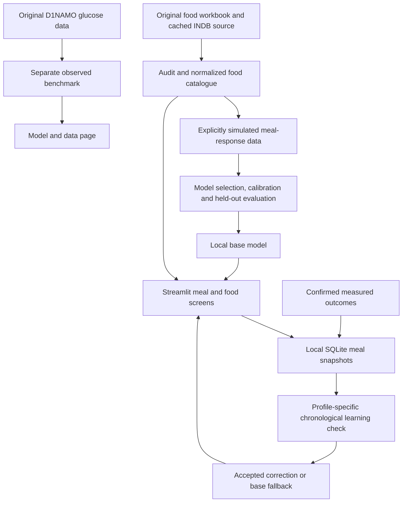

# Glucose Twin: process, models and evidence

Build date: 18 October 2026. Runtime: Python 3.13.13, scikit-learn 1.9.1. This document is generated from the experiment JSON files in `reports/`.

## 1. What has been built

Glucose Twin is a local Streamlit research application. A person enters a premeal reading, the foods and weighed portions they plan to eat, recent activity and sleep. The app estimates glucose at 60 and 120 minutes, presents food composition and gives an evidence-aware assessment. After a meal, actual glucose readings can update a personal residual model. New foods can be added with labelled nutrition information.

This is a computational prototype of a meal-response twin. It is not a validated representation of a patient's physiology. Its initial meal-response model learns a declared simulator, not measured Indian patient outcomes. It must not be used for diagnosis, insulin dosing, medication changes or emergency decisions. There is no demonstrated clinical accuracy for the premeal food model.

The requested allowed/not-allowed function is implemented as a provisional personal shortlist. “Likely suitable” requires repeated comparable measurements as well as an estimate within target. “Review portion”, “Limit / discuss”, “Uncertain” and “Review with care team” preserve the distinctions between a possible high response, observed history and uncertainty. A cold-start prediction does not authorize a food or permanently ban it.

## 2. Sources and preservation

The original workbook has 1,137 rows and 78 exact repeated food names. Its recipe nutrients are not meal-response labels. The existing D1NAMO records contain measured glucose, but are not matched Indian food-composition observations. The PIMA file concerns diabetes classification and contains no suitable longitudinal meal labels, so it is preserved and excluded from response training.

The [INDB provider](https://www.anuvaad.org.in/indian-nutrient-databank/) supplies nutrient estimates for recipes and ingredients. Its [methodology](https://www.anuvaad.org.in/methodology/) explains how ingredient composition and recipe weights were combined. The provider includes IFCT 2017, earlier Indian tables, UK CoFID and USDA sources. The official [ICMR-NIN IFCT publication](https://www.nin.res.in/ebooks/IFCT2017_16122024.pdf) is a reference for the Indian composition tables; this application imports the downloadable INDB workbook rather than silently transcribing PDF values.

The downloaded workbook has 2,109 entries. There are 1,088 normalized names absent from the original workbook. After combining, checking and deduplicating, the working catalogue has **2,140 unique names**, comprising 1,055 recipes and 1,085 composition entries. 1,189 entries are eligible for meal scenarios: recipes, retained manual estimates and fruit entries listed as edible fruit composition. Raw grains, dry legumes, meat and other ingredients remain available for reference but cannot be treated automatically as a cooked meal. A custom food can supply a documented as-eaten recipe.

| Retained source label | Food entries |
| --- | ---: |
| ifct2017 | 528 |
| asc_manual | 488 |
| bfp_manual | 374 |
| ifct2004 | 369 |
| open_source_recipes | 148 |
| ukfct | 134 |
| usda | 54 |
| manual_estimate | 45 |

Source workbook: `https://www.anuvaad.org.in/wp-content/uploads/2020/07/ANUVAAD_INDB_2024.xlsx`. SHA-256: `a9fc3283d04e7573b2e2ce50e5d18e335d4710d3bddd851b9afe02f9c280af00`. Retrieval date: 2026-10-18.

The original data was not overwritten. A SHA-256 manifest and automated test cover 446 original files, including the old meal database. Previous application code and model artifacts were moved to a sibling legacy directory. The new database uses `data/local/twin_v2.sqlite3`; the old `meals.sqlite3` is not automatically imported because its schema and demonstration provenance differ.

## 3. Cleaning and expansion

1. Keep the downloaded source in `data/sources/`; read the original Excel without modifying it.
2. Normalize names by case and punctuation and assign stable hashed food identifiers. Prefer the public source on a normalized-name collision. Retain every duplicate candidate in a separate audit rather than averaging conflicting recipes.
3. Validate finite, nonnegative core nutrients, per-100 g limits, macronutrient mass, energy and sugar/carbohydrate consistency. **7 source rows** fail these checks and are retained in `quarantined_foods.csv`, not used for training.
4. Store nutrition per 100 g. Where several published per-serving nutrient ratios agree, infer a serving mass and label that inference. Otherwise use a clearly stated 100 g reference. Bowl and cup sizes are not assumed to be interchangeable.
5. Generate five portion multipliers: 0.5, 0.75, 1, 1.5 and 2. This yields **10,700 calculated portions**, not additional measured foods.
6. Generate the user-selected **100,000 simulated response scenarios**, with explicit synthetic provenance in every row. These are saved separately from observed data.

Food source definitions of carbohydrate may differ. Fibre is not subtracted from source carbohydrate again. Free sugar is not equivalent to total sugar, and source zeroes do not establish laboratory certainty. No glycemic index is fabricated. The old digestion-time text is not a model feature. Manual estimates and user-added foods receive a wider illustrative range.

Exact-name deduplication does not detect every synonym or recipe variation. Derived category labels are for browsing only; they do not establish regional coverage, clinical quality or glycemic effects.

## 4. Response simulation

The simulator produces one- or two-food meals with varied weights, premeal readings of 80–240 mg/dL, 0–60 minutes of prior activity and 4–10 hours of sleep. Portions are rescaled together to stay inside the declared development bounds. There are 2,000 virtual identifiers with fixed hidden response factors. These are simulated identities, not patient records.

The equations in `scripts/prepare_data.py` define an educational prior. Let C, P, F, B and S denote carbohydrate, protein, fat, fibre and free sugar in grams; G0 is premeal glucose, A is recent activity and H is sleep.

```text
L = C / (1 + 0.025 B + 0.008 P + 0.006 F)
R = (1.05 L + 0.22 S) * hidden_sensitivity * (1 + 0.035 (7-H)) * exp(-0.003 A)
G60  = G0 + R + shared_noise + independent_noise_60
G120 = G0 + hidden_recovery * R + 0.10 F - 0.12 (G0-110)
       + shared_noise + independent_noise_120
```

Hidden sensitivity is lognormal; hidden recovery is sampled from 0.45–0.95. Shared noise has standard deviation 7 mg/dL, and additional noise has standard deviation 5 at 60 minutes and 7 at 120 minutes. Values are bounded to 40–500 mg/dL. These coefficients are explicit assumptions, not coefficients fitted to clinical data or a published validated physiological model. Insulin, medications, absorption, renal function, illness and many other factors are not adequately represented.

The activity and sleep effects are simulator assumptions, not a recommendation to exercise or sleep a specific amount to compensate for food. A larger synthetic sample teaches these assumptions more precisely. It cannot prove that they hold for a particular person.

## 5. Model comparison and fitting

Inputs: premeal glucose, carbohydrate, protein, fat, fibre, free sugar, recent activity and sleep. Targets: 60- and 120-minute glucose. Each regressor learns residuals relative to the premeal reading. This gives a useful baseline structure and keeps prediction and target units explicit.

The experiment compares persistence, scaled Ridge, Extra Trees, Random Forest, two histogram-gradient-boosting configurations and a scaled neural network. The neural network has hidden layers of 64 and 32 ReLU units, regularization and early stopping. The tree configurations, seeds and iteration limits are in the training script. The [scikit-learn documentation](https://scikit-learn.org/stable/modules/generated/sklearn.ensemble.HistGradientBoostingRegressor.html) describes the boosting estimator. All candidates are trained on CPU; specialized hardware is not necessary for this dataset size.

Canonical food IDs are assigned to partitions before generating portions or virtual people. Both foods in a simulated mixed meal belong to the same partition. No exact food ID or virtual-person ID crosses train, validation, calibration or test. The split is 70,000 / 10,000 / 10,000 / 10,000. Related dishes with different names can still overlap semantically, so this is not a cuisine-disjoint experiment.

Selection uses the lowest mean absolute error across both targets on validation only. The winner is then refit on train plus validation. A separate calibration set supplies absolute-error quantiles; the test set is used only for final evaluation. Internal neural-network early stopping is a fitting mechanism within the training pool; it is not the external validation result. The implementation checks split integrity before training.

| Candidate | Validation MAE | MAE at 60 min | MAE at 120 min | Fit seconds |
| --- | ---: | ---: | ---: | ---: |
| Neural network (64, 32) | 8.940 | 8.461 | 9.420 | 3.55 |
| Histogram boosting (15 leaves) | 8.976 | 8.522 | 9.429 | 0.59 |
| Histogram boosting (31 leaves) | 8.989 | 8.529 | 9.449 | 1.03 |
| Extra Trees | 9.046 | 8.601 | 9.492 | 2.38 |
| Random Forest | 9.078 | 8.635 | 9.522 | 5.81 |
| Ridge regression | 9.164 | 8.802 | 9.526 | 0.02 |
| Persistence baseline | 20.593 | 24.050 | 17.135 | 0.04 |

Selected model: **Neural network (64, 32)**. This is the best of the tested configurations on this split, not a claim that it is the best possible diabetes model. Small differences between candidates are not proven statistically significant.

| Held-out synthetic test measure | Result |
| --- | ---: |
| Joint MAE | 9.075 mg/dL |
| 60-minute MAE | 8.591 mg/dL |
| 120-minute MAE | 9.559 mg/dL |
| RMSE | 11.813 mg/dL |
| R squared | 0.9404 |
| Persistence MAE | 22.404 mg/dL |

**All values in this table measure simulator imitation, not clinical accuracy.** Artifact version: `meal-prior-v1-95ad15c785fc`. Training-data hash: `b970f4da52546db1f7da3e2ac61503f262745a2af938cc5981277ea253cc8010`.

The separately calibrated 90th-percentile absolute residuals are 17.71 and 19.06 mg/dL. Marginal synthetic test coverage is 90.0% and 88.9%. Because meals cluster within simulated people and food families, these are empirical results, not an independence-based guarantee. They are not clinical coverage estimates. The app deliberately uses at least ±35 mg/dL, plus extra width for manual food values or personal corrections. The 35 mg/dL floor is an engineering assumption, not a clinically calibrated safety margin.

## 6. Independent observed-glucose experiment

The [original D1NAMO publication and dataset](https://zenodo.org/records/5651217) describe a small healthy and Type 1 cohort. This implementation uses only the explicitly identified Type 1 subset. It converts the source glucose column from mmol/L to mg/dL using 18.0182, with no inference of units from a patient's reading magnitude.

Food events less than 30 minutes apart form one meal. Windows with another recorded meal inside the target horizon are excluded. Nearest glucose measurements must be within eight minutes of the desired offset, and features cannot use readings after the 45-minute forecast landmark. Complete windows use offsets 0, 15, 40, 45, 60 and 120 minutes. The resulting **54 windows from 7 participants** are sparse and affected by treatment and measurement limitations. Missingness and the exclusion rules also introduce selection bias.

Participant-separated development contains 26 windows; the held-out participants contribute 28. Grouped cross-validation on development selects a model. Holdout participants remain excluded from the saved fitted artifact. Food composition is not guessed from unrelated rows or images, and the synthetic nutrition data is never joined to these observations.

| Candidate | Grouped CV MAE | 60-minute MAE | 120-minute MAE |
| --- | ---: | ---: | ---: |
| Persistence | 33.715 | 14.830 | 52.599 |
| Ridge | 32.034 | 15.988 | 48.080 |
| Extra Trees | 28.869 | 14.554 | 43.184 |
| Random Forest | 30.996 | 15.597 | 46.395 |

Selected observed model: **Extra Trees**.

| Observed holdout | Selected model | Persistence |
| --- | ---: | ---: |
| Joint MAE | 28.400 | 28.411 |
| 60-minute MAE | 11.480 | 12.806 |
| 120-minute MAE | 45.320 | 44.016 |

Units are mg/dL. Overall performance is almost the same as persistence, and the two-hour error is worse. This does not justify clinical use. The app exposes this experiment separately in Model & data and never presents it as proof of the premeal food model. It is also not evidence of generalization to Indian Type 2 patients.

## 7. Personal self-learning

This uses **continual supervised residual learning**, rather than reinforcement learning that experiments on a patient's diet. The feedback signal is a measured glucose outcome. The objective is to lower subsequent prediction error; the app does not optimize an insulin dose or a treatment policy.

Each meal stores an immutable food/nutrition snapshot, context, base and personal model versions, predictions made before the recorded outcome, and the illustrative interval. Predictions never become training labels. Only confirmed actual meter/CGM outcomes from the selected profile and the current base model version are eligible. Unknown or optional readings stay missing. Duplicate meal timestamps and repeated outcomes are rejected.

The Log a meal page lets a person select several foods and save their meal directly. The journal accepts readings at 15, 30, 45, 60 minutes (1 hour) and 120 minutes (2 hours). These can be saved incrementally or together, in mg/dL or mmol/L. Missing values are never inferred. All five timepoints and actual elapsed minutes are available in the measured-response chart and CSV export. An additive schema migration preserves existing meal records. Each timepoint has its own recording timestamp and cannot overwrite an existing measurement.

The 15/30/45-minute readings are currently for recording and plotting, not additional training targets. Personal learning still uses the 60/120-minute targets once a two-hour outcome exists. For training eligibility, a two-hour measurement must be at 105–135 minutes and a supplied one-hour measurement must be at 50–70 minutes; otherwise the meal remains in history but is excluded from training. Illness, treatment changes and additional food can be marked as confounders and exclude the outcome. Regular prescribed treatment is not marked as a change, but its unmeasured influence remains a limitation.

With fewer than 12 eligible outcomes, the personal model stays inactive. Once enough data exists, it compares two residual corrections: a shrunk overall/meal-specific offset and regularized Ridge using the eight meal/context features. The final 4–12 chronological meals form a rolling check. Each simulated historical fit uses only earlier outcomes whose recording times precede that validation meal. This prevents backfilled measurements from appearing to be knowledge available in the past.

An update activates only when its mean absolute error improves by at least 5% **and** 1 mg/dL against the base model. If neither correction passes, the base estimate remains in use. Active corrections are refit on eligible history and bounded to ±40 mg/dL. Saving another outcome repeats this check; a failing update falls back to the base estimate. The audit records the number of eligible meals, selected correction, validation errors and version.

This gate is a small-sample engineering check, not a clinical trial. Repeated model selection can be optimistic. There is no guarantee of improvement on future meals. Food evidence is observational: medications, timing, stress and many unrecorded factors can explain a glucose response.

## 8. Personal food-list decisions

The same food components must recur with each component weight within 25% and premeal glucose within 30 mg/dL to count as a comparable meal. A mixed-meal response is not attributed to each individual ingredient.

| Assessment | Rule and interpretation |
| --- | --- |
| Likely suitable | At least three comparable measured meals, at least 80% in target, and the entire illustrative range within target. Still provisional. |
| Limit / discuss | At least three comparable meals, with at least half at or above the upper target. |
| Review with care team | A comparable measured low outcome, or an illustrative range below the lower target. |
| Review portion | The point estimate meets or exceeds the upper target without sufficient personal evidence to make a stronger statement. |
| Uncertain | The upper illustrative range crosses the upper target. |
| Promising / unconfirmed | Range is within target but repeat measured evidence is insufficient. |
| Not assessed | Unsupported ingredient state or inputs outside development bounds. |

These rules are transparent application heuristics, not medical dietary rules. Classification is recalculated when portion, glucose, targets or evidence change. Custom foods start unconfirmed. Food-list CSV exports include reasons, nutrients and sources.

Default targets use 70 mg/dL as a low threshold and an upper two-hour target below 180 mg/dL. [NIDDK](https://www.niddk.nih.gov/health-information/diabetes/overview/managing-diabetes) describes common adult targets and emphasizes individualization. Users can enter clinician-agreed targets. The [ADA 2026 glycemic guidance](https://doi.org/10.2337/dc26-s006) supports handling low glucose separately from ordinary meal planning. The app pauses food ranking for low or markedly high entered readings and directs users to their existing care plan. It gives no insulin or medication instructions.

## 9. Architecture and privacy



The app runs at 127.0.0.1, disables usage statistics and has no patient-data upload or external AI calls. Public-source download happens only in the preparation script. The new database separates profiles and custom foods with scoped queries and uses parameterized SQL. CSV export escapes spreadsheet formulas. Transient predictions are invalidated when inputs, profile or evidence change. Test runs use isolated databases.

Profiles are not an authentication system, and the local database is not encrypted. This is for a trusted personal computer, not public hosting or shared clinical deployment. No claim of regulatory, privacy or medical-device certification is made. Source files retain their upstream attribution and terms.

## 10. Verification and limitations

`tests/test_twin.py` checks original-data hashes, split integrity, food provenance, units, portion scaling, unsupported inputs, cold-start abstention, profile boundaries, duplicates, incremental measurements, atomic batch saves, measurement timing and chronological learning. `tests/test_app.py` exercises all six Streamlit pages and stale-result behavior, custom foods, multi-food logging, incremental journal updates, unit handling and safety messaging. `scripts/browser_check.py` checks the live local browser flow and produces desktop/mobile screenshots.

See `reports/verification.json` for the final recorded verification, and README.md for exact run/rebuild commands. Local passing checks establish software behavior in this environment, not patient benefit.

The remaining scientific gaps are substantial: representative Indian measured meal-response data; matched recipe, portion, treatment and CGM data; validated Type 1/Type 2 and subgroup performance; clinically calibrated uncertainty; prospective evaluation; independent external validation; and review by diabetes clinicians and dietitians. The simulation cannot eliminate the original cohort's geographic or demographic bias. A clinical twin would require those gaps to be resolved before treatment use.
